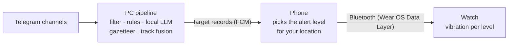

# Alarmer

Targeted air-threat alerts for Ukraine, delivered to a Wear OS watch.

Official air-raid alerts cover a whole oblast or hromada and are easy to tune out. Alarmer reads public monitoring
channels, works out **what** is coming, **where to** and **how soon**, and buzzes your watch with a pattern that
matches the danger at *your* location.

> ⚠️ **Not an official warning system.** Always follow official alerts and the instructions of the authorities.

**Status:** specification phase, no code yet. See [docs/spec.md](docs/spec.md).

## How it works

* **PC:** reads the channels with a dedicated Telegram account, parses posts with rules plus a local LLM, and
  broadcasts every threat as a structured record (type, position, heading, speed, destination).
* **Phone:** decides what's relevant from *time to impact* at your location. Your location never leaves the phone.
* **Watch:** red/orange/yellow patterns, acknowledge, shelter mode.

Running cost: $0/month. Everything is self-hosted except push delivery (Firebase Cloud Messaging, free tier).

## Repository layout

| Path | Contents |
|---|---|
| [docs/spec.md](docs/spec.md) | The specification |
| [docs/adr/](docs/adr/README.md) | Architecture decision records |
| [qna/](qna/) | Question rounds and research notes the spec was built from |
| `pipeline/` | *(planned)* Python PC pipeline, replay harness, evals |
| `android/` | *(planned)* Phone app and Wear OS app (Kotlin) |
| `data/` | Raw Telegram exports, git-ignored |

## Roadmap

M1 parser + replay harness · M2 live PC pipeline · M3 phone app · M4 watch app · M5 calibration and regional
channels. Details are in [spec §11](docs/spec.md#11-milestones).

## Attribution

Track data from [NEPTUN](https://neptun.in.ua) will be used under its API terms, with visible attribution in the app.

## License

Not chosen yet.
