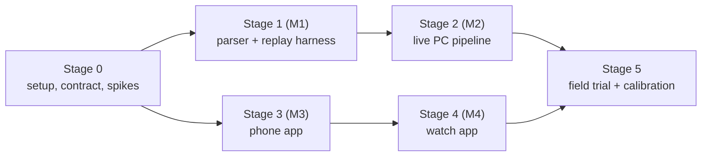

# Alarmer — plan to MVP

**Date:** 2026-10-31 · Builds on [spec.md](spec.md) (milestones M1–M4, §11) and the [ADRs](adr/README.md).

## 1. What "MVP" means

The MVP is the whole chain working live for one user in Kharkiv:

* **Pipeline:** the PC reads `@kpszsu`, Kharkiv Life, `@war_monitor` and `@air_alert_ua`.
* **Phone:** turns the records into levels for your location.
* **Watch:** buzzes with a pattern you can tell apart by feel.

Nationwide coverage comes from the Air Force channel. Neighbourhood precision exists only for Kharkiv. Regional
channels and trust scores come after the MVP.

**Done when:**
1. After two weeks of daily use, **no ballistic-class event for your location was missed** compared with what the Air
   Force and Kharkiv Life posted.
2. You haven't felt the need to mute it. Low-tier buzzes are tolerable, and high-tier ones feel justified.
3. **Fast-path latency** from channel post to watch buzz is measured at **p95 ≤ 3 s**.
4. A second (family) phone can install the app and work with no change on the PC.
5. The open parameters in spec §12 have measured values, or a recorded reason why not.

## 2. How we get there

* **Risk first.** The riskiest assumptions are tested in throwaway spikes before anything is built on them:
  * FCM waking a Xiaomi in Doze;
  * Data Layer vibration on the Galaxy Watch;
  * a 4B model coping with the slang.
* **Two tracks in parallel.**
  * Pipeline track: Stage 1 → Stage 2.
  * Device track: Stage 3 → Stage 4.
  * They meet at a **contract**: the record JSON Schema plus "golden" test vectors (record + location → expected level),
    defined in Stage 0. Both the Python reference level engine and the Kotlin one must pass the same vectors.
* **The replay harness is the test bed.** Every parser or rule change is judged by replaying history. A "replay to
  device" mode pushes historical attacks to a test FCM topic, so the phone and watch get tested against real scenarios.
* **One PR per task group**, with the spec and ADRs updated in the same PR when a decision changes.



Sizes below are rough relative effort: **S** ≈ an evening, **M** ≈ a few evenings, **L** ≈ a week or more of evenings.

## 3. Stage 0 — foundations, contract, spikes

| # | Task | Size | Done when |
|---|---|---|---|
| 0.1 | **Your setup tasks** (§8) | S | Accounts, keys and debugging exist |
| 0.2 | **Repo scaffolding** (§7): `pipeline/` (Python 3.12, `pyproject.toml`, ruff, pytest), `android/` (Gradle wrapper, modules `:shared`, `:phone`, `:wear`), `contracts/`. GitHub Actions: lint + tests for both, plus secret scanning (gitleaks), since the repo is public | M | CI is green on an empty skeleton |
| 0.3 | **Contract v1:** `contracts/record.schema.json` (spec §5) and the first ~30 golden vectors covering every row of spec §6 | M | Schema validates the spec examples; vectors reviewed by you |
| 0.4 | **Spike: walking skeleton.** PC script sends a fake record over FCM → bare phone app → Data Layer → bare watch app plays a per-level waveform | M | See below |
| 0.5 | **Spike: Telethon.** Log in with the second account, receive `@kpszsu` live, fetch one channel's history | S | Post → receive latency measured; history rate measured; `@air_alert_ua` format confirmed |
| 0.6 | **Spike: llama.cpp.** CUDA `llama-server` with Qwen3-4B and Gemma 3 4B, JSON-schema output on ~30 hand-picked messages | S | Tokens/s, per-message latency and VRAM measured; the output looks plausible |

**Spike 0.4 is done when:**
* the latency from PC to watch is measured;
* delivery works with the app swiped away, in forced Doze (`adb shell dumpsys deviceidle force-idle`), and after a
  reboot (with HyperOS Autostart on);
* three waveforms can be told apart blind;
* the skeleton has been left sending a test message every ~15 min for 7 days, to check whether FCM downgrades it
  (spec §12, question 8).

**Exit:** if a spike contradicts an ADR (e.g. FCM unreliable on HyperOS), a superseding ADR comes before Stage 1/3 work
that depends on it. The fallback for FCM is a foreground-service connection (ntfy or WebSocket over Tailscale).

## 4. Pipeline track

### Stage 1 (M1) — parser + replay harness

| # | Task | Size | Done when |
|---|---|---|---|
| 1.1 | **Message store** (SQLite schema per spec §4.1, §4.9) + **HTML export importer** (from the research scripts) + a curated ~2–3k-message test sample in the repo | M | Both exports imported; sample committed; `data/` stays ignored |
| 1.2 | **Pre-filter:** per-channel boilerplate stripping, keyword filter, drift log | S | Unit tests on the sample; ~25% of Kharkiv Life dropped as non-threat |
| 1.3 | **Gazetteer v1** (see below) | L | Every place in the eval set resolves, or is listed as unresolved for you to review |
| 1.4 | **Eval set** (see below) | M | Eval v1 frozen, split into dev and test |
| 1.5 | **Fast path:** rules from spec §4.3, tested against the eval set | M | Recall ≈100% on ballistic-class and `over` events; false-L4 rate reported |
| 1.6 | **LLM extraction:** prompt, output schema (spec §4.4), context assembly (reply chain + last 10 channel messages + active tracks), llama-server client, priority queue | M | Runs end to end on the dev split |
| 1.7 | **Model benchmark:** every candidate on the eval test split, reporting metrics, latency and VRAM | S | Model chosen and recorded in **ADR-0012** |
| 1.8 | **Track fusion v1:** merging, kinematics, expiry (spec §4.6) → records that validate against the contract | L | Replayed reply chains become single tracks with sensible headings |
| 1.9 | **Level engine (Python reference)** + more golden vectors | M | All golden vectors pass; the vectors become the shared spec for the Kotlin port |
| 1.10 | **Replay harness** (see below) | M | See stage exit |

**1.3 Gazetteer v1** covers:
* КАТОТТГ + OSM import for oblasts, raions, hromadas and settlements;
* Kharkiv neighbourhood polygons (OSM, plus hand-drawn where missing);
* the alias table + an inflected-form generator, plus launch areas;
* a simplified export for the phone.

**1.4 Eval set:**
* ~500–1000 messages, stratified sampling across channels, years and formats, including the 20.08.2026 change;
* a labelling guide;
* parallel Sonnet agents in Claude Code label against the §4.4 schema;
* a review file for you, focused on slang and places.

**1.10 Replay harness:**
* replays a time range at N× speed for a configured location;
* outputs records + an alert timeline + a diff against the previous run, as a readable report.

**Exit:** a replay of a recent heavy month for a Kharkiv home location gives an alert timeline you've reviewed and
call sensible, and the eval thresholds are met. The pipeline also processes the busiest day in the exports faster than
real time.

### Stage 2 (M2) — live PC pipeline

| # | Task | Size | Done when |
|---|---|---|---|
| 2.1 | **Telethon ingest service:** live updates, edits, reconnects, `FLOOD_WAIT`, channel config | M | Survives network drops and laptop sleep/wake without losing messages (gaps are backfilled) |
| 2.2 | **Parsers for `@war_monitor` and `@air_alert_ua`**, plus eval samples for both | S | Added to the eval set; thresholds still met |
| 2.3 | **Official alert state + reason** (spec §6.5) | S | Replay shows L1 records with reasons |
| 2.4 | **Publisher** (see below) | M | Test-topic messages reach the skeleton app from 0.4 |
| 2.5 | **Run as a Windows service:** pipeline + `llama-server` start at boot and restart on crash (Task Scheduler or NSSM), log rotation, power settings | S | Survives reboot and a killed process; recorded in **ADR-0013** |
| 2.6 | **Health:** `alarmer status` (Telegram connection, last message per channel, LLM queue, latency p50/p95, FCM errors) | S | Shows a real outage when Wi-Fi is turned off |
| 2.7 | **Latency instrumentation:** per-stage timestamps in every record (spec §9.5) | S | p50/p95 per stage visible in `status` and in replay reports |

**2.4 Publisher:**
* FCM HTTP v1 messages, with coalescing, TTL, `seq`, heartbeats and snapshots (spec §4.8);
* a **dry-run** mode that only logs;
* a **replay-to-device** mode that publishes replays to a test topic.

**Exit:** 72 h unattended in **shadow mode**: live records are logged and published to the test topic, and you
spot-check them against the channels you read. Fast-path p95 from post to FCM-sent is ≤ 1.5 s.

## 5. Device track

### Stage 3 (M3) — phone app

| # | Task | Size | Done when |
|---|---|---|---|
| 3.1 | **FCM receive** and record store, with `seq` / snapshot / TTL handling | M | Replayed bursts and gaps are handled; stale records dropped |
| 3.2 | **Level engine (Kotlin) in `:shared`** | M | Passes every golden vector |
| 3.3 | **Location:** fused last-known location + saved places, background-permission flow | S | Correct fallback when the location is stale or denied |
| 3.4 | **Notifications** (see below) | M | Each level is distinct on the phone with the watch off |
| 3.5 | **Settings:** saved places, night hours, shelter mode, per-level vibration and sound, DND bypass for L4 | M | All settings change behaviour in a replayed scenario |
| 3.6 | **Event log** (a few days of history) with **feedback marks** ("late", "wrong level", "useless", "missed") | S | Marks are exportable for Stage 5 analysis |
| 3.7 | **Monitoring lost** (spec §7.5) | S | Stopping the PC pipeline triggers it once |
| 3.8 | **First run:** disclaimer, HyperOS checklist (Autostart, battery "No restrictions", notifications), permissions | S | A fresh install on a second phone works by following the screens |

**3.4 Notifications:**
* the silent ongoing notification ("Активних загроз поруч: N");
* one notification channel per level;
* vibration patterns, used as the fallback when no watch is connected.

**Exit:** with the watch off, replay-to-device runs of real historical attacks produce the levels the Python harness
predicts, on your phone.

### Stage 4 (M4) — watch app

| # | Task | Size | Done when |
|---|---|---|---|
| 4.1 | **Watch receiver:** `WearableListenerService`, per-level waveforms, local notification with actions | M | Levels are distinguishable blind |
| 4.2 | **L4 full-screen alert**, repeating until acknowledged | S | Repeats until acknowledged, works with the screen off |
| 4.3 | **Shelter mode** synced through the Data Layer; **open on phone** (opens the event log) | S | Shelter set on the watch silences the phone fallback too |
| 4.4 | **Phone → watch delivery:** capability check, local-only phone notifications, phone fallback when the watch is unreachable | S | No double buzz; Bluetooth off → the phone buzzes instead |

**Exit:** replay-to-device runs on the real watch. Acknowledge and shelter mode work, and disconnecting the watch
switches to the phone.

## 6. Stage 5 — field trial and calibration (MVP exit)

| # | Task | Size | Done when |
|---|---|---|---|
| 5.1 | **Kharkiv explosion-vs-threat analysis** from the exports: time from a threat post to an explosion post, by type, and the share of threats that end in an explosion | M | First ETA bands and per-type speeds go into spec §6.2 |
| 5.2 | **Two weeks of daily use**, with feedback marks in the event log | — | Two weeks logged |
| 5.3 | **Tuning:** thresholds, corridor, track lifetimes, anti-spam, night and shelter defaults (spec §12, questions 1–7), each change checked by replay | M | Values recorded in the spec; ADR-0009 superseded if the rules change shape |
| 5.4 | **MVP review** against §1 | S | Go or no-go for post-MVP work |

**After the MVP** (spec §11 "Later"):
* regional channels for all oblasts, plus trust scores;
* NEPTUN corroboration, with attribution;
* a map on the phone;
* per-oblast FCM topics;
* a second pipeline instance;
* Google Play;
* SMS;
* partner data.

## 7. Target repository layout

```
pipeline/            Python PC pipeline
  alarmer/           ingest, prefilter, fastpath, llm, gazetteer, fusion, levels, publish, store
  replay/            replay harness and reports
  evals/             eval set, labelling guide, benchmark
  tests/
android/             Gradle project
  shared/            record model + level engine (Kotlin)
  phone/             phone app
  wear/              watch app
contracts/           record.schema.json, golden level vectors (shared by Python and Kotlin tests)
docs/                spec, plan, ADRs
qna/                 question rounds and research
```

## 8. Things only you can do

| When | What |
|---|---|
| Before 0.5 | Create `api_id`/`api_hash` at my.telegram.org **with the second account**, put them in `pipeline/.env` (git-ignored), and run the login script in your own terminal |
| Before 0.4 | Create a Firebase project (free Spark plan) and add an Android app with the package id `io.github.nesickc.alarmer`. Download `google-services.json` and a service-account key into git-ignored locations; the repo is public. |
| Before 0.4 | Phone: enable developer options with USB debugging and **"Install via USB"**. On HyperOS these may need a SIM and a Mi account signed in. Watch: enable developer options with ADB debugging + debugging over Wi-Fi. |
| Before 0.4 | Approve installing Android SDK platform 36 (the SDK here goes up to 34; the phone runs a newer Android) |
| 0.3, 1.3, 1.4 | Review the golden vectors, the alias table and the eval labels (slang and places) |
| Stage 5 | Wear it, and mark alerts in the event log |

## 9. ADRs expected along the way

| ADR | When |
|---|---|
| [0011](adr/0011-shared-contract-golden-vectors.md) — shared contract and golden vectors | 0.3 |
| 0012 — model choice | After 1.7 |
| 0013 — Windows service hosting | 2.5 |
| Gazetteer data sources and IDs | 1.3, if it deviates from spec §4.5 |
| A superseding ADR for FCM or the Data Layer | Only if spike 0.4 fails |

## 10. Risks

| Risk | Signal | Mitigation |
|---|---|---|
| FCM is delayed or killed on HyperOS | Spike 0.4 | Autostart + no battery restrictions; fall back to a foreground-service connection (new ADR) |
| FCM downgrades our high priority | 7-day test in 0.4 | Ongoing-notification updates; fewer wakes via per-oblast topics |
| A 4B model is too weak on the slang | Benchmark 1.7 | The fast path covers criticals; try 8B or MamayLM with offload; fine-tune a small model on the RTX 5080 |
| The Telegram account gets limited | `FLOOD_WAIT`, errors | Read-only, spread joins, backoff; exports stay as the dataset |
| Format drift | Drift log (1.2) | Refresh the eval set; the LLM path absorbs most changes |
| Watch patterns can't be told apart | Spike 0.4 | Stronger waveforms; a visual colour on the full-screen alert |
| The ballistic rule over-alerts | Field trial | By design. Tune the corridor and ranges with data, never by dropping L4 |
| A secret leaks into the public repo | gitleaks in CI | `.gitignore` covers `.env`, `*.session`, keys |
