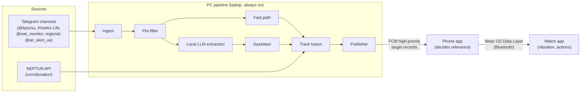

# Alarmer — specification

**Version:** 0.1 (draft) · **Date:** 2026-10-30 · **Status:** ready for MVP work

Decisions behind this spec are recorded as ADRs in [adr/](adr/README.md). The question rounds and research it is built
from are in [../qna/](../qna/). Where this spec and an ADR disagree, the ADR wins and this file gets fixed.

---

## 1. Purpose

Alarmer gives a **granular, targeted warning about incoming air threats in Ukraine**, delivered to a Wear OS watch and
graded by **how soon a threat can reach the user's location**. Existing official alerts are oblast- or hromada-wide and
easy to tune out. Alarmer tells you *what* is coming, *where to*, and *how soon*.

**Users.** The developer and family (≤10 people) at first. Nothing in the design may assume a single user or a single
city, so that it can scale later.

**Coverage.** All of Ukraine.

**Non-goals for v1:**
* replacing official warnings (Alarmer is a supplement; see §10.4);
* iOS, standalone LTE watch use, SMS delivery, Google Play distribution;
* street-level precision (neighbourhood is the best the sources support);
* redistributing anyone's data beyond our own devices.

## 2. System overview



* **PC (the "brain")** reads every source, turns text into structured **target records**, and broadcasts all of
  them. It knows nothing about where the users are. [ADR-0002](adr/0002-pc-pipeline-thin-clients.md)
* **Phone** receives records, works out what matters for its own location, and picks an alert level.
* **Watch** is the output: a vibration pattern per level, short text, and a few actions.

Records don't depend on their source, so a structured military feed could later replace text parsing without changing
the phone or watch. [ADR-0006](adr/0006-target-record-wire-format.md)

**Hardware.** Inference runs on the developer's laptop: RTX 3060 Laptop GPU with 6 GB VRAM, 32 GB RAM, on home backup
power with a UPS-backed router. If a model ever needs training, an RTX 5080 desktop is available. The test devices
are a Xiaomi 17T Pro phone and a Galaxy Watch 7.

## 3. Data sources

[ADR-0003](adr/0003-v1-data-sources.md)

### 3.1 v1 sources

| Source | Role | Notes |
|---|---|---|
| `@kpszsu` (Повітряні Сили) | Primary, nationwide | Semi-structured: a leading emoji gives the class, and reply chains work like track IDs. The format drifts (`🏍`/`💣` appeared 20.08.2026). |
| Kharkiv Life | Primary, Kharkiv | Hyper-local slang, ~25% non-threat posts. Often 30–70 s ahead of the Air Force on ballistics and KAB. Two-thirds of follow-ups have no reply link. |
| `@war_monitor` | Secondary, nationwide | Aggregator. Its type taxonomy is adopted in §5.3. |
| Regional channels | Primary per oblast | To be compiled and scored (§4.7, milestone M5). |
| `@air_alert_ua` (official alerts) | Official alert state | Fixed format, rule-parsed, no LLM. The channel and its format still need checking. Gives the lowest-tier alert (§6.5). |
| NEPTUN open API | Corroboration only | Tracks with id, heading, speed and uncertainty (4–28 km). Poll ≤ every 5 s or use its WebSocket. Visible attribution is required. |

### 3.2 Not used, and why

* **Official-alert APIs** (alerts.in.ua, ukrainealarm): not needed while the Telegram channels are as fast or faster.
* **war-monitor.org API**: deliberately bot-protected (Cloudflare Turnstile + device keys). We don't work around it.
* **єППО**: a reporting app with no outbound feed.

### 3.3 Future sources (hypothetical)

Ask for partner/data access once Alarmer works well:
* war-monitor;
* KB «Технарі» (Флюгер / єППО);
* the military systems «Віраж», «Графіт» and «Дельта».

**Safety requirement for any sensor-derived feed:** assume everything we publish reaches the enemy. Records built from
military sensor data must not let anyone infer sensor locations. That means no sensor IDs, coarsened positions and
timing, and no per-sensor detection geometry. The design gets reviewed before any such feed is connected.

## 4. PC pipeline

Python service on the laptop ([ADR-0010](adr/0010-implementation-languages.md)), running unattended and restarting
itself on failure.

### 4.1 Ingest

[ADR-0004](adr/0004-telegram-mtproto-user-client.md)

* **Client.** A Telethon (MTProto) user client logged into the **dedicated second Telegram account**. It is read-only:
  it never posts or reacts. Live updates arrive over the open connection, typically in under a second.
* **History backfill.** The same client can fetch channel history (for the replay harness, scoring candidate channels,
  and data mining). It respects `FLOOD_WAIT` and spreads channel joins over time. A non-Premium account can join ~500
  channels.
* **Storage.** Every raw message is stored: channel, message id, timestamp, edit timestamp, text, reply-to, media flag.
  Edits are stored as new versions.
* **Secrets.**
  * `api_id`/`api_hash` come from my.telegram.org, created with the second account, and live in a local `.env`.
  * The Telethon `.session` file gives full access to the account. It stays on the PC and is git-ignored.
  * The developer logs in once, interactively in their own terminal, typing the login code and 2FA password
    themselves.

### 4.2 Pre-filter

* Strip per-channel boilerplate, such as Kharkiv Life's `Надіслати новину … / ПІДПИСАТИСЯ` footer.
* A keyword/emoji filter keeps **threat posts and explosion reports**. Everything else (promotions, aftermath, power
  schedules, news) is stored but never parsed further.
* Messages that fail the filter but resemble threat posts get logged, so we notice format drift.

### 4.3 Fast path

Deterministic rules that run before and alongside the LLM, in under 100 ms per message, for the cases where seconds
matter:
* ballistic-class threats and launches (`☄️ Загроза застосування балістичного озброєння…`, `Балістика на …`,
  `Ракета на …`, `Швидкісна ціль на …`, `Загроза (пусків) балістики з <area>`);
* MiG-31K take-offs;
* `над <place>`, `<type> на <place>` for known places;
* official alert on/off, and all-clear posts.

The fast path emits a record immediately. A later LLM result for the same message refines that record rather than
duplicating it.

### 4.4 LLM extraction

[ADR-0005](adr/0005-fast-path-plus-local-llm.md)

* **Engine.** llama.cpp `llama-server` on the laptop GPU, with output constrained to a JSON schema.
* **Model.** The fastest one that passes the eval thresholds (§9.2). Candidates: Qwen3-4B, Qwen3-8B (4-bit), Gemma 3
  4B, plus a Ukrainian-tuned Gemma (MamayLM) as a quality reference.
* **Input.** The message, its reply chain, the last ~10 messages of the same channel (needed because most follow-ups
  carry no reply link), and the currently active tracks for that channel.
* **Output (draft; finalised in M1):**
  ```json
  {"relevant": true,
   "events": [{
     "kind": "threat|launch|movement|over|destroyed|left_area|explosion|all_clear",
     "type": "uav.geran_3", "count": 2,
     "places": [{"text": "Нову Баварію", "role": "towards|over|via|from|at|target"}],
     "direction_from": "north_east", "launch_area": "Брянськ",
     "continues_previous": true, "no_threat_to_city": false }]}
  ```
* The LLM returns place **text**. It never invents coordinates; the gazetteer resolves places (§4.5).
* **Priority queue.** Ballistic-class and "over/at" posts jump ahead of everything else. Under load, the fast path keeps
  firing critical alerts while the queue drains.

### 4.5 Gazetteer

* **Settlements and administrative boundaries** (oblast, raion, hromada) come from OSM plus the official КАТОТТГ
  codifier. IDs are КАТОТТГ codes wherever they exist.
* **Neighbourhood polygons** start with Kharkiv: OSM where it has them, hand-drawn where it doesn't. Other cities
  follow as their channels are added.
* **Alias table:**
  * inflected forms (`Харковом`, `Лубнів`, `на Дергачі`);
  * slang (`ХГ`, `МД`, `ХТЗ`, `Баварія`, `БНР`…);
  * launch areas (Брянськ, Курськ, Бєлгород, Воронеж, Таганрог/Ростов, Крим, occupied territory).

  Aliases are auto-proposed during labelling and then reviewed by the developer.
* A simplified copy of the boundaries, the neighbourhood polygons and the launch-area list ships inside the phone app,
  keyed by the same IDs.

### 4.6 Track fusion

* Merge events into **tracks**. Evidence for a merge: reply chains, a message continuing the previous one, the same
  type, time proximity, and kinematic plausibility under the type's speed (§6.2).
* Estimate position (with an uncertainty radius), heading (± spread) and speed from successive fixes or stated
  direction. Otherwise fall back to the stated destination and the per-type default speed.
* Keep **area threats** (KAB launches on a region, ballistic threats from a direction) separate from point tracks.
* Corroborate with NEPTUN tracks when they match: this raises `conf` and `src_n`.
* Expire tracks after a per-type lifetime (initial guess: Shahed 20 min, jet 10 min, missile 5 min, ballistic 3 min;
  tuned during the MVP), or on `збито` / `вилетів в область` / all-clear.

### 4.7 Source trust

* **Score key:** channel × threat type × region.
* **Score inputs:** confirmation rate (by the Air Force, another channel, or a later explosion), median lead time vs the
  Air Force, and false-alarm rate.
* **Recomputation:** from historical data, **every few months** at most. Manual overrides always win.
* **Use:** above a threshold, a critical keyword fires on its own. Below it, the event needs a second source.
* Until scores exist, `@kpszsu`, Kharkiv Life and `@air_alert_ua` count as trusted.

### 4.8 Publisher

[ADR-0007](adr/0007-fcm-transport.md)

* Records go out as **FCM high-priority data messages** to one topic for all of Ukraine. Per-oblast topics are an
  option for later.
* **Ballistic-class, launch and `over` records go out immediately.** Other records are coalesced for ≤1 s into
  messages of at most 4 KB.
* Each message has an FCM TTL matched to its record (stale threats are worthless), and a monotonic `seq`.
* **Heartbeat.** Every 60 s while any threat is active, every 5 min otherwise.
* **Snapshot.** A full snapshot of active records goes out every 60 s while threats are active, so a phone that missed
  messages catches up without a back-channel.

### 4.9 Storage and logs

SQLite on the PC holds raw messages, filter decisions, LLM inputs and outputs, tracks, published records, and
per-stage timestamps. Raw messages are kept indefinitely because they are the dataset; the rest is kept ≥ 90 days.
Disk use is a few MB per month.

### 4.10 Health

The pipeline logs Telegram connection state, last message time per channel, LLM queue depth and latency, and FCM
errors. A local status page or CLI shows them.

## 5. Target record (wire format v1)

[ADR-0006](adr/0006-target-record-wire-format.md) · exact definition:
[contracts/record.schema.json](../contracts/record.schema.json) ([ADR-0011](adr/0011-shared-contract-golden-vectors.md))

### 5.1 Envelope

FCM data payload:
`{"v":1, "seq":18342, "ts":"2026-10-30T21:14:05Z", "records":[ … ]}`

Snapshots set `"snapshot":true` and carry every active record. A heartbeat is an envelope with an empty `records`.

### 5.2 Record

```json
{"kind":"track", "id":"t-7f3a", "status":"active",
 "type":"uav.geran_3", "count":1,
 "pos":{"lat":50.05, "lon":36.42, "r_km":5},
 "heading":{"deg":250, "pm":30}, "speed_kmh":400,
 "dest":{"id":"UA63120270010096220", "lat":49.99, "lon":36.23, "r_km":12},
 "area":null, "launch_area":null,
 "no_threat_to":null, "reason":null,
 "conf":0.7, "src_n":2, "first_seen":"2026-10-30T21:09:40Z", "last_seen":"2026-10-30T21:14:02Z", "ttl_s":600}
```

| Field | Meaning |
|---|---|
| `kind` | `track` (moving object) · `area` (e.g. "КАБи на північ Харківщини") · `ballistic_threat` (no launch yet) · `launch` (ballistic-class launch) · `explosion` · `official_alert` · `all_clear` |
| `id` | Stable for the life of a track or area; updates reuse it |
| `status` | `active` · `destroyed` · `left` · `expired` |
| `type` | §5.3 taxonomy. Required for `track`, `area`, `ballistic_threat` and `launch`. A `launch` always has a ballistic-class type (§6.3) and a `track` never does. |
| `pos` | A point with uncertainty radius. Every `track` has one. |
| `area` | Gazetteer IDs of the affected areas (oblast/raion/hromada/district/neighbourhood). Required for `area`, `explosion`, `official_alert` and `all_clear`. On a track, the areas it is reported over (`над Салтівкою`). |
| `heading`, `speed_kmh` | Degrees ± spread; speed estimate (falls back to the type default) |
| `dest` | Stated destination (`курсом на X`, `на X`) or a launch's named target, with coordinates and radius inline |
| `launch_area` | Launch-area ID for ballistic-class threats and launches |
| `no_threat_to` | Gazetteer IDs a local channel declared safe ("для нас без загрози") |
| `reason` | `official_alert` only: the threat behind the alert (`kind`, `type`, `launch_area`), taken from the Air Force posts of the same minutes |
| `conf`, `src_n` | Fused confidence 0–1; number of independent sources |
| `first_seen`, `last_seen` | UTC timestamps with a `Z` suffix, like every time in the format |
| `ttl_s` | The phone drops the record after this unless it is refreshed |

Optional fields may be omitted or `null`; both mean "not known". The phone never receives raw post text in v1.

### 5.3 Type taxonomy

Adopted from war-monitor, plus additions:
* `uav.geran_2 / geran_3 / geran_4 / gerbera / garpia / molnia / kub / lancet / recon / unknown`
* `cruise.kh101 / kh55 / kh59 / kh69 / kh22 / kh31p / kh35 / kalibr / iskander_k / oniks / tsirkon / banderol / unknown`
* `ballistic.iskander_m / kn23 / kinzhal / 5v55 / 48n6dm / oreshnik / unknown`
* `kab` · `aviation.tactical / mig31k` · `unknown.fast` · `unknown`

## 6. Threat model and alert levels (phone side)

[ADR-0009](adr/0009-alert-levels-time-to-impact.md) · worked examples: [contracts/golden/](../contracts/golden/README.md),
which both level engines must pass ([ADR-0011](adr/0011-shared-contract-golden-vectors.md))

### 6.1 Levels

| Level | Colour | Watch | Phone (watch not connected) |
|---|---|---|---|
| **L4** | Red | Long pattern, repeats until acknowledged; full-screen | Same pattern; sound optional; DND bypass optional |
| **L3** | Orange | Strong triple buzz | Vibrate |
| **L2** | Yellow | Double buzz | Vibrate |
| **L1** | — | Single short buzz | Vibrate (short) |
| **L0** | — | None (logged, visible in app) | None |
| **All-clear** | — | Gentle distinct pattern | Gentle pattern |
| **Monitoring lost** | — | Distinct pattern (§7.5) | Same |

Sound is always optional and set per level.

### 6.2 Time to impact

Relevance is driven by **time to impact at the user's location**, not distance. Speeds differ by a factor of over 30
between a Geran-2 and a Zircon.

* **Earliest arrival:** `ETA = max(0, distance − r_km) / speed`.
* **Approaching** means:
  * the user is inside the heading cone (heading ± max(spread, 25°)) and the distance is shrinking; or
  * the stated destination is within its uncertainty radius + 10 km of the user.
* **Initial ETA bands**, calibrated in M5 from explosion-vs-threat data:

  | Approaching, ETA | Level |
  |---|---|
  | ≤ 2 min, or `над <user's neighbourhood/district>` | L4 |
  | ≤ 5 min | L3 |
  | ≤ 15 min | L2 |
  | In the user's oblast, not approaching | L1 |
  | Anything else | L0 |

* **Default speeds** (initial values, to be calibrated):

  | Class | Types | Default speed |
  |---|---|---|
  | Slow UAV | `uav.*` except jet | 180 km/h |
  | Jet UAV | `uav.geran_3` | 350 km/h (peaks 500+) |
  | Cruise | `cruise.banderol` | 600 km/h |
  | Cruise | other `cruise.*` | 800 km/h |
  | Fast cruise | `cruise.kh22` | ≈ Mach 3+, ETA-based |
  | Ballistic-class | §6.3 | Rule-based, not ETA |
  | KAB | `kab` | Area-based (§6.4) |

### 6.3 Ballistic-class rule

**Ballistic-class** covers `ballistic.*` (Iskander-M and Kinzhal alike), `cruise.tsirkon`, and `unknown.fast`
("Швидкісна ціль" of unknown type). Banderol and Kh-22 are *not* in this class; they follow the ETA rules. These targets
are too fast for judgement, so the rules are deliberately blunt:

| Situation | Level |
|---|---|
| **Threat** (no launch yet), e.g. `☄️ Загроза застосування балістичного озброєння з півночі`, `Загроза балістики з Брянська`, or a MiG-31K take-off | **L2** within 550 km of the stated launch area. If no area is stated, within 550 km of the Russian border + occupied territory. A MiG-31K take-off is L2 nationwide. |
| **Launch, no target named** | **L4** within 550 km of the launch area (same fallback) |
| **Launch, target named** (`Балістика на Київ`, `Ракета на Харків`) | **L4** within 50 km of the target, and **L4** in the **vector corridor**; **L2** for everyone else in range |
| A local channel says "для нас без загрози" for a city | **L2** for that city |

* **Vector corridor.** Fast targets are a threat along their whole path. Targets get re-predicted in flight: a Zircon
  first called for Kyiv struck Vinnytsia two minutes later. The corridor runs from the launch area along the bearing to
  the named target, ±20°, out to the target plus 150 km.
  * From Sevastopol, Kyiv lies at a bearing of ≈342° and Vinnytsia at ≈325°. A ±20° corridor would have covered that
    case.
* **Belarus is excluded.** Kinzhals launched from Crimea count as their own launch area ("Крим").

### 6.4 Area threats

| Situation | Level |
|---|---|
| `КАБ на <user's district/neighbourhood>` | L4 |
| `КАБ на <user's hromada/city>` | L3 |
| KAB on a neighbouring hromada | L2 |
| KAB elsewhere in the oblast | L1 |

Other area-only threats follow the same ladder.

### 6.5 Official alert, explosions, all-clear

* **Official alert** for the user's area starts → **L1**, with its reason ("Тривога · ☄️ загроза балістики з
  півночі"). This is the lowest buzzing tier. Alarmer never suppresses or downgrades anything the official alert says.
* **Explosion reported** in the user's neighbourhood or district → L2; in the user's city → L1.
* **All-clear** for the user's area, or the last relevant track ends → the all-clear pattern.

### 6.6 Repeats and upgrades

An update to the same track or area buzzes again only if its level **rises**. Further anti-spam rules wait for MVP
experience. During mass attacks every alert may be useful, so nothing is throttled in v1.

## 7. Phone app

Kotlin + Jetpack Compose, Android 14+, sideloaded.

### 7.1 Receiving

* A `FirebaseMessagingService` receives each message, checks `seq`/`ttl`, updates its record store, and evaluates
  levels.
* No foreground service is needed in v1. Each received message updates a **silent ongoing notification**
  ("Активних загроз поруч: N"), which keeps FCM high priority from being downgraded. A spike must confirm this
  works.
* **Location.** Use the last known fused location if it's under 15 min old; otherwise the active saved place (home /
  work / parents…). Needs background-location permission. **The location never leaves the phone.**

### 7.2 Delivering

* If the watch app is reachable (Data Layer node with our capability), send it the alert. The matching phone
  notification is marked local-only so the watch doesn't buzz twice.
* Otherwise the phone vibrates with the level's pattern. Sound only if enabled for that level.
* **Text format:** two short lines, no source shown. For example:
  ```
  🏍 Реактивний → Салтівка · ~3 хв
  L3 · рухається на вас
  ```

### 7.3 Settings

* saved places;
* night hours, with which levels are muted or batched during them;
* shelter mode: which levels are suppressed (default ≤ L2) and for how long (default 30 min);
* per-level vibration and sound;
* DND bypass for L4;
* language. UI text is Ukrainian only, but all strings live in resources so other languages can be added.

### 7.4 Event log and map

* An event log of received records and fired alerts, kept for a few days.
* A map of active tracks comes after the MVP.

### 7.5 Monitoring lost

No message or heartbeat for 2 min while a threat is active nearby (10 min otherwise) gives a distinct "моніторинг
втрачено" buzz, once, and shows it in the ongoing notification. SMS fallback is parked (§11).

### 7.6 Device setup (Xiaomi HyperOS)

The app needs Autostart enabled and battery set to "No restrictions", or FCM can't start it. The app shows a setup
checklist on first run.

### 7.7 Legal text

* A disclaimer: not an official warning system; always follow official alerts.
* NEPTUN attribution.

## 8. Watch app

Wear OS 5+, Kotlin + Compose for Wear OS, target device Galaxy Watch 7.
[ADR-0008](adr/0008-wear-os-data-layer-watch-app.md)

* Receives alerts from the phone over the **Data Layer `MessageClient`** (Bluetooth, no internet needed).
* Plays a **vibration waveform per level** (§6.1).
* L4 opens a full-screen alert that repeats until acknowledged.
* **Actions:**
  * **Acknowledge:** stops the repeat.
  * **Shelter mode:** suppresses the configured levels for the configured time; synced with the phone.
  * **Open map on phone.** Until the map exists, this opens the event log.
* If the watch app isn't installed, bridged phone notifications still arrive, without custom patterns.

## 9. Testing and evaluation

### 9.1 Replay harness (first deliverable)

* Feeds stored channel history (the HTML exports now, Telethon history later) through the real pipeline at real or
  accelerated speed.
* For a configured user location, it records every published record and every alert that would have fired.
* It diffs runs, so every parser or rule change shows what it changed.

### 9.2 Eval set and model choice

* **Labelling.** About 500–1000 messages, labelled with the §4.4 schema by **parallel Sonnet agents in Claude Code**.
  Sampling is stratified across channels, years and formats, deliberately covering the 20.08.2026 format change.
* **Review.** The developer reviews the Kharkiv slang and place resolution.
* **Metrics:**
  * recall on ballistic-class and `over` events (target ≈100%);
  * false-L4 rate;
  * event-type accuracy;
  * place-resolution accuracy;
  * p95 latency per stage.
* **Model choice.** The fastest candidate model that meets the thresholds wins, and is re-checked when channels or
  formats change.

### 9.3 Drift monitoring

Track the per-channel rate of "looks like a threat post but parsed to nothing". Flag a jump.

### 9.4 Data mining (after the parser works)

* Measure the time from a threat post to an explosion report, by type and city. This gives the ETA bands (§6.2) and
  the share of threats that end in impact.
* Lead time and agreement between channels feed the trust scores (§4.7).

### 9.5 Latency instrumentation

Every record carries per-stage timestamps (post time → received → filtered → fast path / LLM → fused → sent). The phone
and watch log receipt and buzz times, so end-to-end latency can be measured live.

## 10. Non-functional requirements

### 10.1 Latency

As low as possible. p95 targets from channel post to watch buzz:

| Path | p95 target |
|---|---|
| Fast path | ≤ 3 s |
| LLM path, off-peak | ≤ 10 s |

Rough budget: Telegram delivery ≤ 1 s, fast path ≤ 0.1 s, FCM ≤ 1.5 s, phone + Bluetooth ≤ 0.5 s.

### 10.2 Availability

* The pipeline restarts itself after crashes and reboots.
* The laptop runs on home backup power, and the router is on a UPS.
* The design allows a second pipeline instance later.

### 10.3 Cost

**$0/month** excluding electricity. FCM, Telethon and llama.cpp are free; labelling uses the Claude Code
subscription.

### 10.4 Privacy and legal

* **Privacy.**
  * User location stays on the phone.
  * The PC broadcasts everything to everyone.
  * Secrets (Telegram `api_id`/`api_hash` and session, Firebase service account) stay local and git-ignored.
* **Legal.**
  * Not an official warning system: the disclaimer appears in the app.
  * NEPTUN is used under its terms, with attribution.
  * No redistribution beyond our own devices.

### 10.5 Localisation

Ukrainian now; strings are externalised from day one.

## 11. Milestones

The step-by-step plan to the MVP, with tasks and exit criteria, is in [plan.md](plan.md).

| # | Deliverable |
|---|---|
| M0 | This spec + ADRs + README |
| M1 | Parser (pre-filter, fast path, LLM extraction, gazetteer for Kharkiv + oblast centres) + replay harness + eval set + model benchmark. Starts with `@kpszsu` and Kharkiv Life. |
| M2 | Live PC pipeline: Telethon ingest (+ `@war_monitor`, `@air_alert_ua`), track fusion, FCM publisher, health status |
| M3 | Phone app: FCM receive, level engine (§6), ongoing notification, phone-vibration fallback, settings, event log |
| M4 | Watch app: per-level patterns, L4 full-screen + acknowledge, shelter mode, open-on-phone |
| M5 | Calibration: explosion-vs-threat mining, ETA bands, per-type speeds, track lifetimes (the Kharkiv part is the MVP field trial, plan Stage 5). Regional channel list + trust scores (after the MVP). |
| Later | Map on phone; NEPTUN corroboration in fusion; per-oblast FCM topics if needed; second pipeline instance; SMS fallback; Google Play; partner data (§3.3) |

## 12. Open questions (decided during the MVP)

Each has a working default in the text above.

1. ETA band thresholds and per-type speeds (§6.2): calibrate in M5.
2. Vector corridor width, extent and level (§6.3): ±20°, target + 150 km, L4 for now.
3. Is "Швидкісна ціль" of unknown type always ballistic-class (§6.3)? Yes for now.
4. Track lifetimes per type (§4.6).
5. Anti-spam during mass attacks (§6.6): nothing throttled in v1.
6. Defaults for night hours and shelter mode (§7.3).
7. Monitoring-lost thresholds (§7.5): 2 / 10 min.
8. Does updating an ongoing notification keep FCM high priority (§7.1)? Needs a spike.
9. Per-oblast FCM topics (§4.8): only if wake count or battery use becomes a problem.
10. Whether to show a confidence hint on the watch, and how to make it meaningful.
11. The `@air_alert_ua` channel and its format (§3.1): verify in M2.
12. Regional channel list and trust thresholds (§4.7): M5.

## 13. Glossary

| Term | Meaning |
|---|---|
| БпЛА / Шахед / Герань | Attack UAV. Geran-2 is propeller-driven; Geran-3 (`🏍`, "реактивний", "реактив") is jet-powered. |
| Молнія | Small strike UAV ("Молния") |
| КР | Крилата ракета (cruise missile) |
| Бандероль | S8000 hybrid drone/cruise missile (cruise class) |
| КАБ | Керована авіаційна бомба (guided glide bomb) |
| Балістика / Іскандер / Кинджал | Ballistic-class missiles |
| Циркон | Tsirkon/Zircon, hypersonic; treated as ballistic-class |
| Швидкісна ціль | "Fast target" of unannounced type |
| МіГ-31К | Kinzhal carrier; its take-off is a nationwide threat |
| ХГ, МД, ХТЗ, Баварія… | Kharkiv neighbourhood slang (alias table, §4.5) |
| БНР | Belgorod direction |
| upd: без фіксації / Чисто | No further sightings / clear |
| Відбій | All-clear |
| КАТОТТГ | Official codifier of administrative units; source of our area IDs |
